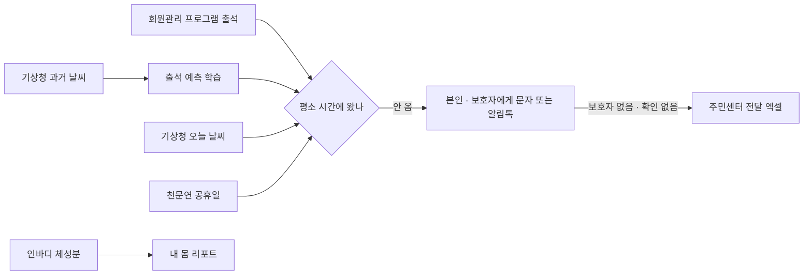

# 공공체육시설 출석 기반 고독사 위험 조기 발견 · 건강 리포트

2026 공공 AI 대전환 챌린지 세션 1 출품작 · 용인도시공사

꾸준히 나오던 어르신이 몇 주째 안 보이는데 아무도 모르는 일을 막습니다. 체육시설이 이미 가진 출석 기록으로 회원마다 평소 오는 요일과 시간을 찾고, 그 시간에 안 오면 본인 → 보호자 → 주민센터 순으로 연락합니다. 새 장비는 필요 없습니다. 회원에게는 출석·체성분·식단을 묶은 건강 리포트를 보여 줍니다.

> **설치 없이 보기** · 온라인 시연판: https://kyle-bbajo.github.io/health-report/
>
> 가상 회원 60명, 2026-10-26 낮 12시 화면입니다. 회원 화면은 비워 두고 '내 리포트 보기'(또는 `yuc` / `2011`). 저장·문자 발송·엑셀 내려받기는 설치판에서 동작합니다.




| 문서 | 내용 |
|---|---|
| README (이 문서) | 하는 일, 설치와 실행, 판단 방식 요약 |
| [기술 설명](docs/기술설명.md) | 판단 기준, 출석 예측 모델, 외부 연결, 안전 장치를 숫자까지 |
| [운영안내](docs/운영안내.md) | 기관에 들일 때: 회원관리 DB 연결, 문자 발송, 장애 대응, 다른 기기에서 열기 |

---

## 1. 하는 일

| 기능 | 내용 |
|---|---|
| 안부 확인 | 평소 오던 날 2번 연속 안 오면 본인에게, 3번이면 동의한 보호자에게 문자(또는 알림톡). 폭염·한파 예보일엔 2번부터 보호자에게 |
| 주민센터 연계 | 보호자가 없거나 확인이 없는 회원만 명단에 남고, 직원은 엑셀로 내려받아 전달 |
| 회원 화면 | 평소 시간이 지나면 먼저 알림. 30일 뒤 체지방률, 출석 달력, 강좌 추천, 식단 기록 |
| 보호자 | 회원이 직접 등록하고, 출석을 보여 줄지도 회원이 정함 |
| 강좌 화면 | 요일·시간별 시간표. 강좌를 누르면 수강 회원의 오늘 출석과 보호자 |
| 선택 기능 (기본 꺼짐) | 보호자 건강 리포트(체성분·식단), 어린이 강좌 출결 알림. 설정 → 기능에서 켬 |

---

## 2. 설치와 실행

```
git clone https://gitlab.aigov.go.kr/qkrwngh10/health-report.git
cd health-report
```

| PC | 처음 한 번 | 실행 |
|---|---|---|
| 맥 | `bash setup.sh` | `NOW=12:00 bash run.sh` |
| 윈도우 | `run.bat` 더블클릭 (설치와 실행을 한 번에) | 다시 `run.bat` 더블클릭 |
| 리눅스 · WSL | `bash setup.sh` | `NOW=12:00 bash run.sh` |

아무것도 깔리지 않은 PC에서도 Python, 패키지, 가상 데이터, 문장 모델(gemma3:4b)까지 알아서 설치합니다. 처음에는 10~20분 걸리고, MySQL이나 문장 모델을 받지 못해도 나머지는 그대로 동작합니다. 자세한 설치 옵션은 [기술 설명 1장](docs/기술설명.md#1-설치-자세히).

실행하면 브라우저에 첫 화면(http://localhost:8000)이 열립니다.

| 들어가기 | 보이는 것 |
|---|---|
| 관리자 (http://localhost:8000/admin, 시연은 비밀번호 없이 '들어가기') | 회원 목록, 장기 미출석, 강좌, 문자 |
| 회원: 비워 두고 '내 리포트 보기' (용도공, `yuc` / `2011`) | "오늘 수영 초급 시간이 지났어요". 10월 14일 뒤로 못 나와 보호자 안부 단계 |
| 회원 `M051` / `1956` | 보호자 등록 → 동의 → 안부 알림 |
| 회원 `M004` / `1974` | 내 몸·건강·식단 |

---

## 3. 어떻게 판단하나

누구에게 연락할지는 규칙이 정하고, AI는 규칙으로 안 되는 일만 맡습니다. AI가 없거나 실패해도 연락은 빠지지 않습니다.

| 일 | 방법 |
|---|---|
| 평소 오는 요일·시간, 연속 미출석, 연락 단계 | 규칙 (최근 26주 출석 기록) |
| 미출석을 몇 시에 알릴지 | 머신러닝: 그래디언트 부스팅, 특징 17개 (날씨·시설 흐름 포함). 규칙보다 나을 때만 사용 |
| 30일 뒤 체지방률 | 생리학 공식 + 검증될 때만 릿지 회귀 보정 |
| 안내 문장, 회원 글 이해, 음식 사진, 시간표 이미지 | 문장 모델 gemma3 (Ollama, 기관 PC 안). 안부 문자는 모델 없이 정해진 문장만 |

가상 회원 2만 명·10년치(출석 423만 건) 실험 결과입니다. 실제 효과는 기관 자료로 다시 학습해야 압니다.

| 항목 | 결과 |
|---|---|
| 미출석 알림 누락 | 0건 / 7,434건 |
| 헛알림 (알렸는데 늦게라도 온 날) | 규칙보다 25~32% 적음 |
| 학습 시간 | 1분 52초 (일반 PC, CPU 2개·메모리 8GB) |

---

## 4. 안전

- 회원관리 DB를 못 읽으면 판정과 자동 문자를 멈추고, 다시 읽히면 재개합니다.
- 문자를 보내다 끊기면 다시 보내지 않고 직원 확인으로 남깁니다. 같은 일로 두 번 보내지 않습니다.
- 휴회·휴관일·수강 기간 밖은 미출석으로 세지 않습니다.
- 회원관리 DB와 인바디는 조회 전용으로 읽기만 하고, 문장 모델은 기관 PC 안에서 돌아 자료가 밖으로 나가지 않습니다.
- 실제 회원 자료는 없습니다. 실제 자료 구조와 유사하게 생성한 가상 데이터이고, 전화번호는 쓰지 않는 010-0 대역입니다.

알려진 제약(본인인증, 개인정보 승인, 알림톡 등)은 [기술 설명 4장](docs/기술설명.md#4-안전과-제약).

---

## 5. 저장소

```
app.py  config.json  setup.sh  run.sh  run.bat
adapters/   회원관리 프로그램 · 인바디 · 건강검진 읽기
core/       판정 · 출석 예측 · 보호자 · 문자 · 체지방 예측 · 추천 · 식단 · 날씨 · 휴관일 · 시간표
templates/ static/   화면
scripts/    가상 데이터 · 가상 DB 생성
tests/      python -m unittest tests.test_core (154개)
docs/       기술설명 · 운영안내 · 화면 캡처
```

- 패키지: Flask, pandas, numpy, scikit-learn, holidays, cryptography (+ pymysql). CDN 없음.
- `.env`, `*.mdb`, `data/output/`은 커밋되지 않습니다.
- 코드는 용인도시공사 소유이며 대회 규정에 따라 행정안전부에 무상 사용권을 부여합니다. 오픈소스·자료 라이선스는 [LICENSE](LICENSE).
